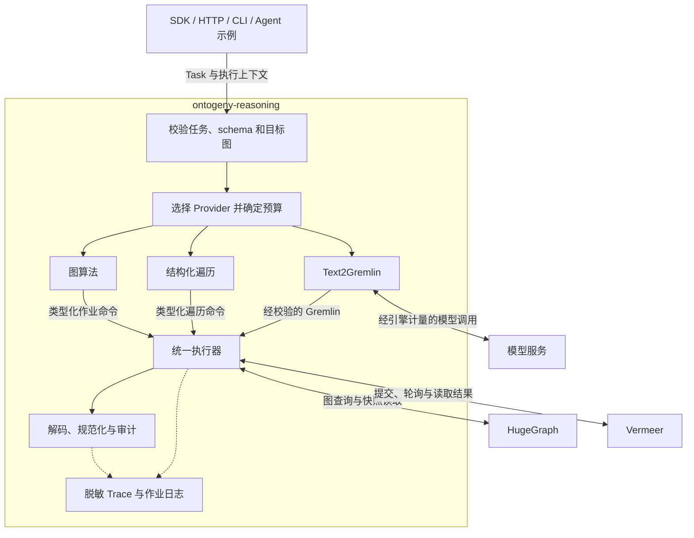

# OSPP 项目申请书

## 摘要


## 项目理解和源码分析

`HugeGraph-ai`在 HugeGraph 的基础上，提供了许多基于图构建 AI 应用的能力，其中也包含了多种多样的图推理能力。

其中 `hugegraph-llm` 提供了自然语言到 Gremlin 的转换、GraphRAG。这个子项目的设计类似 LangGraph, 把这些能力封装一个 `flow`, 只需定义一些节点做什么事，然后组装成一个完整的流程。

### Text2Gremlin

流程主要有四个节点。首先，第一个节点`schema_node` 从 HugeGraph 读取图 schema，第二个节点`gremlin_example_index_query` 负责查找和当前问题相似的 Gremlin 示例。
然后第三个节点`text2gremlin` 把问题和图模式放进提示词，调用 2次 LLM 生成两条候选查询。这里比较特殊的设计就是提示词会放一些example来指导 LLM， 所以一次调用使用的是写死的固定example，而另一次则用检索到的相似示例。
最后一个节点`gremlin_execute` 把对应的查询交给 HugeGraph 执行。

### GraphRAG

GraphRAG 也是一个 flow，由几个节点组成。首先，节点`KeywordExtractNode` 从问题里提取关键词，节点`SemanticIdQueryNode` 根据关键词找到图里的相关顶点。
`GraphQueryNode` 节点从这些顶点出发查找周围的关系，`MergeRerankNode` 节点把和问题更相关的结果排在前面。有了这些，`AnswerSynthesizeNode` 节点把问题和查到的图信息一起交给 LLM，生成答案。

### 图遍历与图算法

图遍历的原生接口封装在 `hugegraph-python-client` 里的 `TraverserManager`。调用时先通过 `client.traverser()` 拿到这个类的实例，再根据需要选择方法。
它提供了许多比较常见的图算法，比如`k_neighbor` 查一个顶点几跳以内的邻居。`shortest_path` 查两个点之间的最短路径。`weighted_shortest_path` 查带权最短路等等。

图算法这边，`hugegraph-python-client` 里的 `RankManager` 封装了两种排名算法。`personal_rank` 接收一个起点和边类型，计算图里其他顶点相对于这个起点的得分。`neighbor_rank` 可以指定每一步的遍历方向和边类型，计算从起点到达其他顶点的概率。

### Ontogeny

Ontogeny 是一个业务本体平台。它通过用一系列 `YAML` 声明式定义业务里有哪些对象、对象之间有什么关系、用户能对它们做什么。

主要暴露的图相关是`QueryService.traverse`和 `hugegraph-llm` 里的 `TraverserManager`差不多，也是提供图的遍历，比如多条查询。

还可以用`Projection` 配置选出要放进图里的对象、属性和关系。对象映射成顶点，关系映射成边，把这些生命式的对象存到图里。


## 需求分析

上面这些能力已经能查图和算图，但放到一个应用里用时，每条链路的参数、结果和报错都不一样。这个项目要把这些问题放到一个推理包里统一处理。具体的详细需求如下

### 独立使用和统一接口

`ontogeny-reasoning` 可以单独安装。应用通过 Python SDK、HTTP 或 CLI 调用，图 schema 可以从 HugeGraph 读取，也可以由 Ontogeny 的本体快照提供。

同时三个入口使用同一套结构。`Task` 写要做什么，`Plan` 记录打算怎么做，`Result` 返回结果或错误。

### 多类 Provider

Provider 是实现具体图查询或图计算的模块。引擎收到 `Task` 后，会选一个能处理这类任务的 Provider。比如查某个点的两跳邻居，图遍历 Provider 会把任务转成 HugeGraph 的遍历请求，再把返回的数据整理成统一格式。以后换一种实现，应用还是用同一套接口。

下面是拟定要实现的一些provider：

- `Text2Gremlin` 先把问题转成中间表示（IR），按图 schema 检查，再生成 Gremlin 并做静态校验。
- 图遍历支持 k 跳邻域、最短路径、加权最短路径、子图和可达性。
- 图算法按用途分四类。`PageRank` 算顶点的重要程度，`BFS` 和 `SSSP` 算从起点出发的跳数和最短距离，`WCC` 和 `CDLP` 分别找连通分量和社区，`LCC` 算一个顶点的邻居之间连得有多紧。
- Agent Provider（可选）用于处理需要多步查询和计算的图推理任务。

### 可观测性、审计和回放

一次执行用同一个 trace ID 串起任务、计划、尝试和结果，记录各步耗时、失败原因和预算用量。审计用这些记录检查执行是否符合计划、结果是否遵守权限、预算是否算对。回放可以查看当时保存的记录。

### 评估体系

每个 Provider 都要做 benchmark 测评。根据它支持的能力，分别检查结果是否正确、运行开销有多大。最后提供可复现的测评脚本和报告。


## 前期调研

图查询和图计算是很常见的需求，开源社区已经有不少成熟的实现。这里主要看了 `GraphScope`、`Neo4j` 和 `NetworkX` 的图查询和图计算，以及几种 Text2SQL 的实现。

### Text2SQL 实现

这里看了三种 Text2SQL 实现，分别是 `LangChain`、`IRNet` 和 `Vanna`。

- **LangChain。** 先从数据库读取表结构，也可以附上几行样例数据。再把这些信息和用户问题放进提示词，让 LLM 按对应的数据库方言生成 SQL。生成后把 SQL 文本交给调用方，由调用方决定是否执行。 [LangChain 源码](https://github.com/langchain-ai/langchain/blob/ced9bdb1a8899516b6c541fc0e19ab5f349aa0ea/libs/langchain/langchain_classic/chains/sql_database/query.py)
- **IRNet。** 先把问题里提到的内容和数据库里的表、列对应起来。模型根据这些信息生成中间表示 `SemQL`，再由程序按固定规则把它转成 SQL。 [IRNet 论文](https://aclanthology.org/P19-1444/) · [源码](https://github.com/microsoft/IRNet)
- **Vanna 0.x。** 先存入建表语句、业务文档和已有的问题和SQL示例。收到新问题后，从这些资料里找相关的内容和相似示例，再放进提示词让 LLM 生成 SQL。配置好数据库连接后，还可以接着执行 SQL 并返回查询结果。 [Vanna 0.x 源码](https://github.com/vanna-ai/vanna/blob/main/src/vanna/legacy/base/base.py)

### 图推理能力支持

这里分别看了 GraphScope、Neo4j 和 NetworkX 的遍历接口和内置图算法。

- **GraphScope。** 交互查询引擎可以用 Gremlin 按跳数展开路径、找可达的点，也可以把选中的边提取成子图。图分析引擎的内置算法包括 PageRank、WCC、SSSP、BFS、CDLP 和 LCC。 [Gremlin 遍历文档](https://graphscope.io/docs/interactive_engine/tinkerpop/faq) · [内置算法](https://graphscope.io/docs/analytical_engine/builtin_algorithms)
- **Neo4j。** Cypher 可以匹配多跳路径，也能按跳数找最短路径。GDS 提供 BFS 和 DFS，还能用 Dijkstra 算带权最短路径。在图投影上可以跑 PageRank、WCC、标签传播和 LCC。 [Cypher 路径查询](https://neo4j.com/docs/cypher-manual/current/patterns/) · [GDS 算法列表](https://neo4j.com/docs/graph-data-science/current/operations-reference/algorithm-references/)
- **NetworkX。** 可以做 BFS、DFS、无权和带权最短路径、可达性判断，也可以从一个点出发取几跳范围内的子图。图算法包括单源最短路径、PageRank、WCC、标签传播和局部聚类系数。 [NetworkX 算法列表](https://networkx.org/documentation/stable/reference/algorithms/index.html) · [邻域子图](https://networkx.org/documentation/stable/reference/generated/networkx.generators.ego.ego_graph.html)

同一类算法的输出也有区别。比如 Neo4j GDS 的 BFS 可以返回顶点的访问顺序，NetworkX 则提供了直接返回每个可达点最少跳数的接口。 [Neo4j BFS](https://neo4j.com/docs/graph-data-science/current/algorithms/bfs/) · [NetworkX 最少跳数](https://networkx.org/documentation/stable/reference/algorithms/generated/networkx.algorithms.shortest_paths.unweighted.single_source_shortest_path_length.html)

#### 任务书以外的算法

- **路径。** Neo4j GDS 和 NetworkX 都可以用 Yen 算法找起点到终点的多条备选路径。GraphScope 还可以算全点对最短路径，用来查询任意两点之间的距离。 [Neo4j Yen](https://neo4j.com/docs/graph-data-science/current/algorithms/yens/) · [NetworkX 简单路径](https://networkx.org/documentation/stable/reference/algorithms/generated/networkx.algorithms.simple_paths.shortest_simple_paths.html) · [GraphScope 内置算法](https://graphscope.io/docs/analytical_engine/builtin_algorithms)
- **中心性。** 三个项目都有介数中心性，可以找出经常出现在其他点对最短路径上的顶点。比如在交通网络里，用它找可能承担较多中转的站点。 [GraphScope 内置算法](https://graphscope.io/docs/analytical_engine/builtin_algorithms) · [Neo4j 中心性算法](https://neo4j.com/docs/graph-data-science/current/algorithms/centrality/) · [NetworkX 介数中心性](https://networkx.org/documentation/stable/reference/algorithms/generated/networkx.algorithms.centrality.betweenness_centrality.html)
- **社区发现。** Neo4j GDS 提供 Louvain 和 Leiden，NetworkX 也提供 Louvain。它们用来把内部连接比较紧密的点划到同一个社区。 [Neo4j 社区发现算法](https://neo4j.com/docs/graph-data-science/current/algorithms/community/) · [NetworkX Louvain](https://networkx.org/documentation/stable/reference/algorithms/generated/networkx.algorithms.community.louvain.louvain_communities.html)
- **核心子图。** 三个项目都有 k-core，可以找出子图内每个点的度都至少为 k 的部分。 [GraphScope 内置算法](https://graphscope.io/docs/analytical_engine/builtin_algorithms) · [Neo4j 算法列表](https://neo4j.com/docs/graph-data-science/current/operations-reference/algorithm-references/) · [NetworkX k-core](https://networkx.org/documentation/stable/reference/algorithms/generated/networkx.algorithms.core.k_core.html)
- **链路预测。** Neo4j GDS 和 NetworkX 都有 Adamic–Adar，可以根据共同邻居给两个点之间可能出现的关系打分。 [Neo4j 链路预测](https://neo4j.com/docs/graph-data-science/current/algorithms/linkprediction/) · [NetworkX 链路预测](https://networkx.org/documentation/stable/reference/algorithms/link_prediction.html)

### 测评

任务书里的三个主要 benchmark 分别测自然语言查图、多跳遍历和图算法。

- **CypherBench 测自然语言查图。** 用参考 Cypher 核对查询结果（EX）和匹配子图（PSJS），也统计无效查询率。把同一份图导入 HugeGraph 并对齐点、边 ID 后，用同一模型和问题集比较直接生成 Gremlin 和先生成 IR 的两条流程。 [CypherBench 论文](https://aclanthology.org/2025.acl-long.438/) · [数据与评测代码](https://github.com/megagonlabs/cypherbench)
- **LDBC SNB 测多跳遍历。** 用社交网络图做测试。比如沿某一关系查两个人之间的最短路径跳数。先核对查询结果，再比较直接调用 HugeGraph 和经过推理包的 p95 延迟。 [LDBC SNB](https://ldbcouncil.org/benchmarks/snb/) · [Query 13 规范](https://ldbcouncil.org/ldbc_snb_docs/interactive-complex-read-13.pdf)
- **LDBC Graphalytics 测图算法。** 它提供图数据和参考输出，覆盖 PageRank、WCC、SSSP、BFS、CDLP 和 LCC。用参考输出核对结果、统计通过用例数，并分别记录图加载、算法计算和完整作业的耗时。 [Graphalytics 算法](https://ldbcouncil.org/benchmarks/graphalytics/algorithms/) · [数据集](https://ldbcouncil.org/benchmarks/graphalytics/datasets/) · [评测规范](https://ldbcouncil.org/ldbc_graphalytics_docs/graphalytics_spec.pdf)

如果实现可选的 Agent Provider，可以再用 **HotpotQA** 或 **MuSiQue** 测多步问答。HotpotQA 标出了回答所需的证据句，MuSiQue 把相互依赖的单步问题组合成多步问题，可以检查 Agent 能否结合多处证据得到正确答案。 [HotpotQA](https://hotpotqa.github.io/) · [MuSiQue 论文](https://aclanthology.org/2022.tacl-1.31/)

#### 其他常用 benchmark

- **LSQB** 用社交网络图测子图匹配，给出九种带标签的查询模式，可以核对匹配数量和运行时间。 [论文与代码](https://github.com/ldbc/lsqb)
- **GAP Benchmark Suite** 提供 BFS、SSSP、PageRank、连通分量、介数中心性和三角形计数的参考实现，可以对照结果和性能。 [GAPBS 仓库](https://github.com/sbeamer/gapbs)
- **Graph500** 用大规模合成图测 BFS 和 SSSP，以每秒遍历的边数（TEPS）衡量吞吐。 [Graph500 规范](https://graph500.org/?page_id=12)
- **KQA Pro** 给复杂的知识库问题配上参考答案、SPARQL 和 KoPL 程序，可以分别检查最终答案和中间步骤。 [KQA Pro 论文](https://aclanthology.org/2022.acl-long.422/)


## 设计方案

### Ontogeny Reasoning 技术设计

本方案对应 OSPP 项目 26ec80107。详细字段、操作边界和测试用例见[技术规格](.workflow/ontogeny-reasoning/design.md)。

#### 1. 概述

`ontogeny-reasoning` 是一个可独立安装的 Python 包。它将自然语言查图、结构化遍历和图算法接到同一套任务契约和执行引擎。核心交付包括三类 Provider、SDK／HTTP／CLI、目标图校验、预算控制、审计和回放、一致性测试、三组评估，以及 Ontogeny 接入和一个可运行的 Agent SDK 调用示例。完整的 Agent 规划、执行与验证流程属于扩展目标。

#### 2. 系统架构



各入口将 `Task` 和宿主提供的执行上下文交给同一引擎。引擎核对任务目标和 schema 是否与宿主选定的图一致，再按任务语义和预算选择 Provider。Provider 准备命令并解码后端响应。统一执行器负责凭据解析、实际下发、限额和作业状态。结果校验后封装为统一的 `Result`。

#### 3. 数据模型

##### Task

`Task` 是 SDK、HTTP 和 CLI 共用的请求结构。字段名后的 `?` 表示可省略。

```text
Task {
    version: 1
    request_id: string
    target: string
    schema: string
    operation: Operation
    limits?: Limits
}
```

- `version` 是契约版本。不兼容的版本返回 `incompatible_version`。
- `request_id` 用于追踪和识别重复请求，长度为 1–128 个字符，允许字母、数字、点、下划线、冒号和连字符。
- `target` 是目标图别名，由宿主提供的执行上下文解析为具体图和连接配置。
- `schema` 是 schema 别名或 SHA-256 指纹，用于校验操作引用的标签、属性和边端点。
- `operation` 包含必填的 `kind` 和该操作的参数。自然语言查询、结构化遍历和图算法各有参数结构。引擎先按 `kind` 校验参数，再选择支持该操作和约束的 Provider。同一 `kind` 的不同实现接收同一参数结构。
- `limits` 是可选的请求预算，内部字段也可按需填写。

**Operation**

`operation.kind` 是必填的操作标识，其值决定同一对象中的其余字段。下方的 `&` 表示将公共字段与对应分支合并到一个对象。

```text
Operation = TextToGremlinOperation | TraversalOperation | AlgorithmOperation

TextToGremlinOperation {
    kind: "text_to_gremlin"
    question: string
    output: "vertices" | "edges" | "paths" | "count"
}

TraversalFields {
    source: VertexRef
    edge_labels: string[]
    direction: "out" | "in" | "both"
    max_depth: int
    edge_where?: Predicate[]
}

TraversalOperation = TraversalFields & (
      { kind: "k_hop" | "subgraph" }
    | { kind: "shortest_path" | "reachability", target: VertexRef }
    | { kind: "weighted_shortest_path", target: VertexRef, weight_property: string }
)

AlgorithmOperation = { directed: boolean } & (
      { kind: "pagerank", damping: number, iterations: int }
    | { kind: "wcc" }
    | { kind: "sssp", source: VertexRef, weight_property: string }
    | { kind: "bfs", source: VertexRef }
    | { kind: "cdlp", iterations: int }
    | { kind: "lcc" }
)

VertexRef { label: string, id: { kind: "string" | "int64", value: string } }
Predicate { property: string, op: "eq" | "lt" | "lte" | "gt" | "gte", value: string | number | boolean }
```

`question` 的 UTF-8 编码最多 8 KiB。`edge_labels` 至少含一个标签，`max_depth` 为非负整数。`edge_where` 最多含八个条件，所有条件须同时满足，值的类型由 schema 决定。`int64` ID 用十进制字符串表示。算法的 `directed` 指定有向或无向图，`iterations` 为正整数，`damping` 为 `[0, 1]` 内的有限数值。

**Limits**

```text
Limits {
    wall_ms?: int
    attempts?: int
    model_calls?: int
    model_tokens?: int
    backend_requests?: int
    graph_work?: int
    transport_bytes?: int
    result_items?: int
    result_bytes?: int
    required_backend_limits?: map<string, int>
}
```

`wall_ms` 和 `attempts` 必须为正，其余限值为非负整数。`required_backend_limits` 记录必须由后端落实的指标及上限。省略项采用宿主默认值，显式请求受宿主上限约束。

| 契约 | 职责 |
|---|---|
| `SchemaSnapshot` | 从配置目标的 HugeGraph schema 或 Ontogeny 投影快照取得标签、属性、标识键和边端点，规范化后生成指纹。 |
| `ExecutionView` | 记录宿主为本次任务选定的图或投影、允许的操作和返回值，以及 schema、数据版本、宿主权限策略版本和有效期。通过 `ExecutionContext` 传入。 |
| `Plan` | 记录目标图、schema 指纹、数据和权限策略版本、Provider、执行命令和生效预算。回退会产生关联原计划的子计划。 |
| `Result` | 返回状态与完整性、类型化数据或结构化错误，并携带计划引用、Provider、trace ID、远端作业状态、预算和审计结果。 |
| `ReasoningError` | 包含稳定错误码、发生阶段、是否可重试及脱敏详情。端点在本次任务使用的图中缺失时返回 `entity_not_found`。 |


#### 4. 公共接口

| 入口 | 调用方式 |
|---|---|
| SDK | `await engine.run(task, context=ctx)`，返回 `Result` 对象。 |
| HTTP | `POST /v1/runs`，请求体为 `Task` JSON，响应为 `Result` JSON，响应头带 `X-Trace-Id`。 |
| CLI | `ontogeny-reasoning run --config view.json --file task.json`，标准输出为同一份 `Result` JSON。 |

完整结果对应 HTTP `200` 和 CLI 退出码 `0`，包括确定不可达。拒绝、超时和后端故障用相同的结构化错误码区分。回放也由三个入口访问，调用者显式选择证据回放或实时重跑。

#### 5. 核心执行流程

##### 5.1 解析、路由与下发

Provider 工厂通过 Python 入口点组 `ontogeny_reasoning.providers` 注册。三类 Provider 实现同一组方法。

```python
class Provider(Protocol):
    def manifest(self) -> ProviderManifest: ...
    async def prepare(
        self, task: Task, schema: SchemaSnapshot, context: PrepareContext
    ) -> Command: ...
    def decode(self, command: Command, response: BackendResponse) -> CandidateResult: ...
```

- `manifest()` 声明支持的操作、语义版本、后端配置、可落实的限制和成本等级。
- `prepare()` 将任务转换为类型化命令，例如遍历请求、校验后的 Gremlin 查询或计算作业。需要模型时，通过 `PrepareContext` 提供的计量接口调用。
- `decode()` 将后端响应转为候选结果，由引擎检查输出类型、宿主指定的输出限制和预算，再封装成统一的 `Result`。

统一执行器负责凭据、实际下发、超时和作业状态。它在下发前核对计划中的目标图，引擎在交付前确认该图与宿主提供的执行上下文仍一致。

##### 5.2 自然语言转 Gremlin

模型生成结构化 IR，描述起始标签或 ID、类型化过滤条件、有限跳数的定向边步骤和输出形式。引擎先按所选图的 schema 校验，再从允许的遍历步骤编译 Gremlin，静态检查参数、深度、绑定图及输出。无效候选最多修复一次，第二次失败返回 `candidate_rejected`。Standalone RocksDB 首先验证图作用域的 Gremlin 作业接口及其实际限制。[HugeGraph 1.7 Gremlin API](https://hugegraph.apache.org/versions/1.7/docs/clients/restful-api/gremlin/)

##### 5.3 结构化遍历


##### 5.4 图算法与作业生命周期

| 算法 | 输出与验证要点 |
|---|---|
| PageRank | 每个顶点的分数，按指定阻尼和迭代次数验证，并核对无出边顶点的质量分配。 |
| WCC | 每个顶点的弱连通分量，含孤立点，按分区等价验证。 |
| SSSP、BFS | 从源点出发的最短距离或跳数，遵循输入方向，不可达项用 `null`。 |
| CDLP | 同步标签传播的社区编号，按固定并列规则验证。 |
| LCC | 局部聚类系数，核对有向邻居间的边和低度顶点。 |

Vermeer 从 BFS 作业开始验证加载、轮询和结果读取，再逐项检查参考语义。直读 RocksDB 不可用时，尝试导出调用者可访问的图并保留可逆 ID 映射。后端存在语义缺口时，在同一份图快照上验证补充实现。算法验收覆盖全部参考顶点，按 Graphalytics 要求进行精确、分区等价或浮点容差比较。[Graphalytics 规范](https://ldbcouncil.org/ldbc_graphalytics_docs/graphalytics_spec.pdf) · [Vermeer 作业客户端](vermeer-python-client/src/pyvermeer/api/task.py)

**作业生命周期。** 向远端提交前将意图写入 SQLite 日志，以调用主体和请求 ID 去重，收到作业句柄后立即持久化并在预算内轮询。回执丢失时先查原作业，无法确认则返回 `submission_unknown` 并冻结重派。超时或取消后尝试终止已知作业，并记录远端终止是否得到确认。

##### 5.5 Ontogeny 与 Agent 示例

Ontogeny 根据测试用户的权限选图。普通用户使用只含 A 和 C 的图，特权用户使用包含 A–B–C 完整路径的图。同一个两跳任务应分别得到不可达与可达。Ontogeny 按当前权限将返回的 ID 映射到对象并脱敏。Agent 示例经公开 SDK 发送一条有类型的任务，读取结果或结构化错误和 trace ID。[Ontogeny 查询服务](ontogeny/server/ontogeny/engine/service.py)

#### 6. 非功能需求

**预算。** 每个任务共用截止时间和预算账本，覆盖尝试次数、模型用量、图工作量、传输字节及结果大小。生效限制取请求上限和宿主上限中的较小值。客户端超时、响应上限和可验证的后端工作量分别计量，请求的硬限制需由所选执行配置落实。

**可观测性、审计和回放。** Trace 关联校验、路由、模型、下发、轮询和结果，审计记录计划一致性、输出是否符合宿主给出的限制，以及预算核算。证据回放读取脱敏记录。实时重跑使用宿主重新提供的执行上下文和新预算，并报告数据或 schema 变化。

#### 7. 测试与评估策略

统一测试套件覆盖三个入口、独立安装、schema 校验和目标图一致性、重复提交、超时与回执丢失。遍历用例包含环、平行边、等长路线、缺失端点、端点间无路径和搜索截断。真实环境逐项记录操作语义、约束和结果证据。

| 评估 | 对照与指标 |
|---|---|
| CypherBench NBA | 固定 50 个问题，用同一模型、schema、图和预算比较直接 Gremlin 与 IR 流程，报告 EX、PSJS、无效查询率和失败数。 |
| LDBC SNB | 用 IC13 与有限深度扩展核对路径长度和可达性，与等价的 HugeGraph 直连请求比较 p95 延迟及引擎开销。 |
| Graphalytics | 用有向和无向参考图验证六种算法，分别报告图加载、计算、结果读取和端到端耗时。 |

提交数据版本、用例 ID、转换与评分规则、运行配置及原始统计。参考正确性用例必须通过，查询质量和性能报告观测结果与分母。


## 项目排期


## 个人经历


## After OSPP
